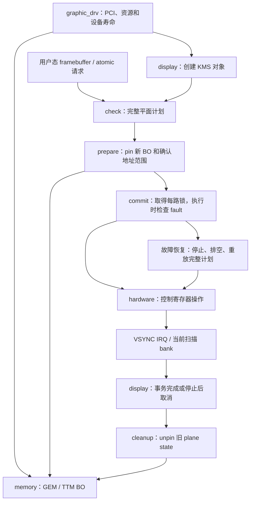

# graphic：四层职责与一次显示提交

本文按 2026-10-04 的新接口契约说明重构。**新架构已通过目标 W=1、层边界检查、实机回归、故障恢复及重启接管；范围见 validation.md**；历史版本的运行记录不能替代新版本验证。硬件范围见 [硬件契约](hardware-contract.md)，阅读顺序见 [学习路线](learning-guide.md)，历史来源见 [来源记录](source-provenance.md)。

这里的“完整软件架构”指资源取得、BO、KMS 对象、提交完成和释放都有明确的负责人和连接方式。它不等于芯片全部功能都已实现：初版仍继承一个已配置模式，没有 DDC/EDID、PHY 调频或 GPU 加速。

## 四层各回答一个问题

| 层 | 负责的问题 | 对外契约 |
| --- | --- | --- |
| 根目录设备层 | 设备是谁，寄存器和显存归谁，何时对用户可见，何时停止 | `graphic_device` 聚合资源、硬件上下文和两个不透明子系统；PCI probe/remove/shutdown 统一入口 |
| `memory/` | 像素存在哪里，如何分配、清零、映射、固定和释放 | 以 GEM 对象交接；`graphic_bo_pin()` 成功交付一个 VRAM pin 和 PCI bus 地址，由调用者配对 unpin |
| `display/` | 用户请求是否合法，哪些平面一起改变，何时可以退还旧 BO | DRM plane/CRTC/encoder/connector；完整提交计划、每路串行执行、IRQ 与提交完成、故障恢复 |
| `hardware/` | LS7A2000 的已知操作如何变成寄存器访问 | 普通 timing/link 结构、整数地址和管线编号；唯一执行 DC/PLL 控制寄存器 MMIO 的层，不依赖 DRM/TTM 类型 |

不再为套用 i915 目录外形保留空的 module/PCI/VGA/mitigations 包装。需要的 PCI 和模块入口放在设备层；硬件寄存器集中在后端；其余按实际生命周期拆分。VRAM 像素映射属于 memory 的存储职责，与访问 DC/PLL 控制寄存器不同。

## 文件导航

下表描述新架构文件，不把仍在历史提交中的同名旧文件当成实现参考。

| 文件 | 阅读时应找的内容 |
| --- | --- |
| [graphic_drv.c](../graphic_drv.c) | DRM/PCI 注册，配对 GPU 的 VRAM 所有权，窗口映射，probe 与停止顺序 |
| [graphic_device.h](../graphic_device.h) | `graphic_vram` 的两个地址视角；`graphic_device` 的聚合关系 |
| [memory/graphic_bo.c](../memory/graphic_bo.c) | TTM 私有管理、BO 生命周期、dumb 创建/清零、映射和 pin/unpin |
| [memory/graphic_bo.h](../memory/graphic_bo.h) | memory 的小接口；display 不应透过它操作 TTM placement/resource |
| [display/graphic_kms.c](../display/graphic_kms.c) | KMS 初始化、atomic 总检查/commit tail、IRQ 分派、polling 和 stop |
| [display/graphic_kms.h](../display/graphic_kms.h) | 根目录只需知道 `graphic_kms_init()` / `graphic_kms_stop()` |
| [display/graphic_display.h](../display/graphic_display.h) | display 私有对象、每路 `commit_lock`、`graphic_flip` 完成与事件所有权 |
| [display/graphic_plane.c](../display/graphic_plane.c) | 格式/坐标/大小/BO 范围检查；prepared state 持有 pin；primary/cursor 计划重放 |
| [display/graphic_crtc.c](../display/graphic_crtc.c) | 模式检查、显示启停、vblank 接口和运行时恢复 |
| [display/graphic_output.c](../display/graphic_output.c) | 把后端快照转换为 DRM mode；connector 检测和单模式发布 |
| [display/graphic_flip.c](../display/graphic_flip.c) | 每次更新的开始、arm、IRQ 完成、有界等待与取消，包含无用户事件的更新 |
| [hardware/ls7a2000.c](../hardware/ls7a2000.c) | 按手册实现快照、扫描、光标、输出、IRQ 和保守排空 |
| [hardware/ls7a2000.h](../hardware/ls7a2000.h) | 不含 DRM/TTM 的后端契约；`ls7a2000_link` 是继承快照而非调频请求 |
| [hardware/ls7a2000_regs.h](../hardware/ls7a2000_regs.h) | 后端私有寄存器定义，字段必须能回到手册出处 |
| [tests/kms-smoke.c](../tests/kms-smoke.c) | 从用户态验证 BO、模式、vblank、翻页和光标；退出时先停扫描再释放 |
| [Makefile](../Makefile) | 实际参与构建的对象；目录中存在文件不代表它被编译 |

## 两种地址，三种对象

`graphic_vram.cpu_start` 是 CPU 访问 PCI 资源的地址；`bus_start` 是 PCI bus 视角的地址。CPU mmap 使用前者所属的资源窗口，后端扫描使用由后者得到的地址。二者在某台机器上不同完全可能，不能拿 CPU 地址截成低 32 位后写显示寄存器。

memory 用 BO 在 VRAM 中的偏移形成 bus 地址；plane 再加经过边界检查的像素数据偏移。加法、乘法、BO 长度及 32 位扫描范围在交接前检查。后端收到 `u32 bus_address` 时，合法性和 pin 必须已经建立，不能在写寄存器时补做可能失败的分配。

BO 是持有像素存储的 GEM/TTM 对象；framebuffer 描述如何解释该存储，包括格式、pitch 和 offset；plane state 决定用哪份 framebuffer、扫描哪一段以及放到哪里。framebuffer ID 不是物理地址，BO 存在也不代表其 VRAM 位置已固定。

## check、prepare、commit、retire 的责任

1. **check**：只检查新状态，形成完整平面计划。它检查模式与继承值严格匹配、布局/坐标、尺寸、stride、算术溢出和 BO 可见区间。为了运行时恢复，计划必须包含需要重放的 primary 和 cursor，而不能只有本次显式修改的一个字段。
2. **prepare**：为新 plane state 取得独立 pin，确认最终 bus 地址区间并准备同步依赖。复制一个 plane state 不能继承旧 state 的 pin 所有权；准备失败要释放本次已经取得的 pin。
3. **commit**：在每路 `commit_lock` 下执行已经准备好的计划，发布硬件更新和软件完成事务。故障可能在 check 之后才出现，所以执行时再次检查 `fault`，决定是否先恢复整条管线。
4. **retire**：观察该事务的完成，或先停止硬件并完成保守排空后取消事务，之后才清理旧 state 的 pin。提交函数返回、软件状态已交换与硬件已经停止使用旧地址是不同时间点。

`owns_pin` 属于 prepared plane state。cleanup 与最终 state 销毁都可能走到释放路径，因此必须避免重复 unpin。TTM 的内部引用、用户 GEM handle、mmap 和显示 pin 各有用途，不能用其中一个替代另一个。

## 无用户事件也要等完成

用户可不请求 page-flip event，光标更新也经常没有 `state->event`。但换光标 BO 后，硬件仍可能在读取旧地址。没有用户通知需求，并不意味着旧 BO 可以立即迁移或释放。

因此 `graphic_flip` 的 completion 独立于可选用户事件存在。普通主平面切换需要观察新的 vblank 与目标 bank；更换光标 BO 的无事件更新也须等到退休边界，再清理旧 plane state。

同一 FB 的纯坐标移动立即完成：新状态仍持有同一个 BO 的 pin，旧状态清理不会使硬件失去存储。仅更新位置/必要热点，不重写图像地址。显隐变化、图像更换、模式启用和故障恢复仍等待。硬件位置读回可以下一帧才反映请求；提交与内存所有权收尾不代表显示器已经发光。用户事件是这个事务可选的通知载荷，不是事务是否存在的开关。

IRQ 完成和错误取消竞争同一份 `pending`、event 和 vblank 引用。必须只有取得所有权的一方收尾、释放引用并唤醒等待者。一次取消只表明软件可以继续收尾，不能被解释为那幅画面已经成功显示。

## 两种管理寿命与锁

| 对象或资源 | 主要寿命 | 必须保证的关系 |
| --- | --- | --- |
| PCI 使能、DC/桥片窗口等 devm/pcim 资源 | PCI 绑定寿命 | 资源回收前停止所有 MMIO 消费者、IRQ/polling 和提交工作 |
| DRM 对象及 drmm 动作 | 最后一个 DRM 引用结束 | 可能晚于 PCI remove；不能认为 unregister 已释放全部 BO/打开的 fd |
| VRAM region 所有权 | 随 DRM 管理动作保留 | KMS/BO/TTM 清理完以后才归还；注册动作的逆序回收关系要能核对 |
| 新旧 plane state 的 scanout pin | prepare 到对应 cleanup | 正常完成或停用排空以前不得释放旧 pin |

`devm_drm_dev_alloc()` 中的 devm 管的是 PCI 持有的 DRM 引用，不是允许忽略 DRM 的引用计数。打开 fd 时强制解绑/热拔的入口阻断与迟到访问需要专项验证，不能由“用了 devm/drmm”自动推出安全。

| 锁 | 保护内容 | 上下文 |
| --- | --- | --- |
| `graphic_pipe.commit_lock` | 一路完整硬件计划及其退休/恢复过程 | 进程上下文；可等待，IRQ 不取此 mutex |
| `graphic_flip.lock` | pending/event/completion 的发布与独占收尾权 | IRQ 与进程路径共享；持锁不睡眠 |
| `ls7a2000_hw.irq_lock` | 中断软件 enable mask 和混合 W1C 寄存器写入 | 后端内部自旋锁 |
| GEM/TTM reservation | BO 位置、pin 与映射相关状态 | memory 内部按通用 TTM 契约使用 |

事务锁只保护领取和移交，交给 DRM 发送 event 或归还 vblank 引用前先释放它，避免与 DRM 的 event/vblank 锁嵌套。多路提交按固定管线顺序取 mutex，收尾时反向释放。

## 故障与验证边界

完成等待超时、继承时钟改变或重新启用失败，需要进入显式故障路径。恢复发生在 commit 执行时：拿到串行锁，再看实时 `fault`，停止并排空输出，重放本次完整且已准备的 primary/cursor 状态，再尝试启用。不能只在 atomic_check 缓存一个“当时正常”的布尔值后一直沿用。

初始化时先捕获两路固件配置，再显式停止并排空旧扫描，随后才注册 DRM/client 和分配显示 BO。DRM reset 后的软件 inactive 不能代替这个接管步骤。

初始化失败、停止和卸载也要终结仍在等待的事务，先结束硬件访问再让 managed 清理释放后面的对象。手册没有 DMA-idle 完成位；帧时间排空是工程策略，证明边界见 [硬件契约](hardware-contract.md)。

验收应分别记录目标提交/内核、W=1 构建、普通显示和翻页、无事件光标 BO 更换、超时后的恢复、失败回滚与卸载。文档本身没有完成这些验证；画面颜色、Alpha 和边缘裁剪也需要实际观察，不能仅以 ioctl 返回成功代替。
